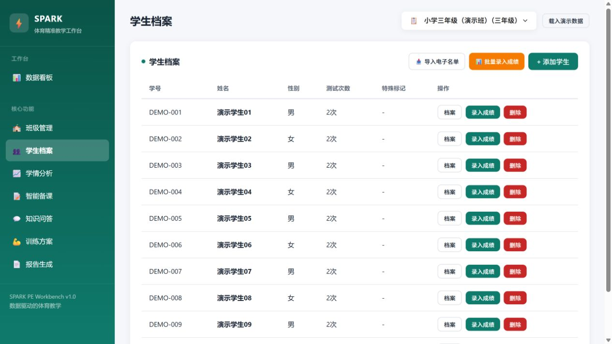
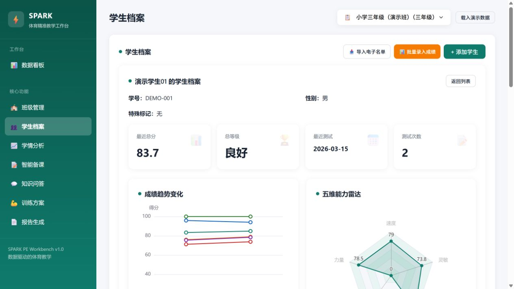

# SPARK 体育精准教学工作台

面向中小学体育教师的 AI 应用，将班级管理、学生体测、学情分析和备课流程集中在本地 Web 工作台。

个人独立项目。我负责客户需求沟通、方案设计与调整、开发、交付微调及 API 配置指导。此处为作品展示的脱敏源码副本，演示学校、学生及成绩均重新生成。

## 主要流程

- 管理学校、班级及学生档案。
- 下载名单模板，预览校验 Excel/CSV，再确认导入。
- 录入体测成绩，查看热力图、个人雷达图、趋势和异常提示。
- 接入文本模型，辅助问答、训练方案、教案与报告生成。
- 使用 SQLite 本地持久化，图表资源随源码提供。

技术栈：Python、FastAPI、SQLAlchemy、SQLite、原生 HTML/CSS/JavaScript、ECharts、文本模型 API。

## 本地运行

建议 Python 3.11。首次安装依赖后，Windows 可双击根目录 `start_demo.bat`：它会启动本地服务并尝试自动打开浏览器。保持启动窗口打开，再点击“载入演示数据”。不要双击 `frontend/index.html`。

首次安装依赖或手动启动，在根目录执行：

```powershell
python -m venv .venv
.venv/Scripts/python.exe -m pip install -r backend/requirements.txt
.venv/Scripts/python.exe scripts/run_local.py
```

浏览器打开 `http://127.0.0.1:8000/`；接口文档在 `/docs`。不要直接双击 HTML。模型名继承原配置，可按服务账户调整，本次未验证其当前可用性。不要提交真实密钥。

**本地演示数据、名单和图表无需 API Key。** 未提供 `config.yaml` 时自动读取无密钥模板。AI 生成需要自己的有效密钥、网络和额度：可复制模板为 `config.yaml` 后填写，或设置 `DEEPSEEK_API_KEY` 环境变量，再重启服务。未配置时 AI 接口返回明确提示，不发起模型请求。本轮核对没有调用付费模型。

## 演示

### 界面预览

以下为本地实际运行的虚构名单和学生档案。成绩和图表由程序规则计算，不是实时模型输出。





当前版本待修复的显示问题：数据看板部分统计人数与选中班级人数不一致；档案“最近测试”摘要未选中日期最新的记录。截图保留原始界面，不作为统计准确性的证明；详细边界见[演示说明](docs/demo.md)。

用全新空数据库启动后，点击“载入演示数据”：3 个班级、30 名虚构学生、60 条记录。已有班级或学生时会拒绝载入。见 [演示说明](docs/demo.md)。

当前为本地运行候选版，尚未部署线上体验。GitHub Pages 不能直接运行 Python 后端；后续作品站将提供静态素材与独立演示入口。

## 目录

```text
backend/                       API、数据模型、评分和模型调用
frontend/                      界面与本地图表资源
scripts/generate_demo_data.py   可复现的虚构数据生成器
scripts/run_local.py            启动本地服务并打开浏览器
start_demo.bat                  Windows 启动入口
demo_data.json                 虚构数据
national_fitness_standard.json  原项目规则表
config.yaml.template           无密钥模板
docs/                          演示、隐私和版本说明
third_party/                   第三方许可与声明
```

## 当前边界

- OCR 照片/扫描件导入是预留接口，尚未实现。
- 评分表及逻辑沿用原项目，未逐项对照权威标准复核，不能作为正式体测评定依据。
- 本地单用户应用尚无公网账户、权限和用量管理，公开在线演示需要单独配置。
- 本轮仅整理脱敏与验证现有流程，未升级依赖，未做完整安全审计。
- 原创代码许可证待确认；第三方组件遵循各自许可。

[隐私与脱敏](docs/privacy.md) · [源码基线](docs/version-selection.md) · [第三方说明](THIRD_PARTY_NOTICES.md)
